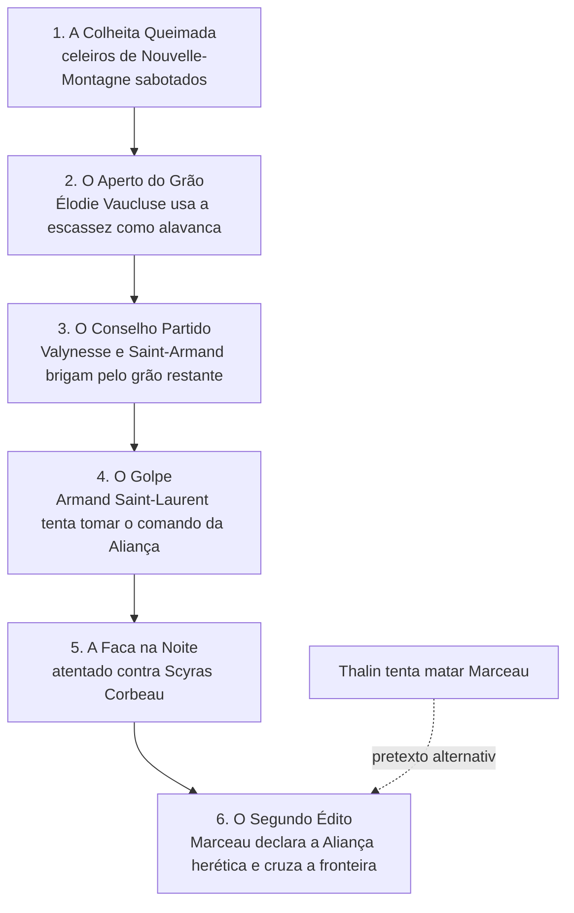

---
tags:
  - Campanha
---

# O estopim

!!! warning "`POSSIBILIDADE`"
    Proposta de campanha, não cânone.

A guerra não começa com uma declaração: começa com uma **cadeia de crises**, cada uma
provocada ou explorada por L'Ordre. Os jogadores podem intervir em cada elo. Cada elo que eles
resolverem enfraquece a invasão; cada elo que falhar a fortalece.

## A cadeia recomendada

### 1. A Colheita Queimada

Incêndios e uma praga estranha atingem os celeiros de
[Nouvelle-Montagne](../cidades/nouvelle-montagne.md). Parece acidente.

- **Verdade:** agentes de L'Ordre, guiados por informações de
  [Thibault de la Rivière](../personagens/thibault-de-la-riviere.md) sobre as rotas de
  abastecimento, sabotaram os estoques.
- **Se os jogadores investigarem:** encontram um sabotador ligado a
  [Chantépierre](../cidades/chantepierre.md) e a primeira prova de que L'Ordre se prepara.

### 2. O Aperto do Grão

Com menos comida, [Élodie Vaucluse](../personagens/elodie-vaucluse.md) convence o conselho de
chefes a vender o grão restante a quem oferecer mais, e não a quem precisa mais.
[Pierre Montaigne](../personagens/pierre-montaigne.md) se opõe.

- **Se os jogadores ajudarem Montaigne:** o grão chega à fronteira; Élodie vira inimiga.
- **Se Élodie vencer:** Saint-Armand passa fome e Armand ganha motivo para agir.

### 3. O Conselho Partido

No conselho da Aliança, [Lorenzo Magnetér](../personagens/lorenzo-magneter.md) exige o grão para
Valynesse; [Armand Saint-Laurent](../personagens/armand-saint-laurent.md) exige para os soldados.
[Jeanesse Lumière](../personagens/jeanesse-lumiere.md) aproveita para resistir a uma nova taxa.
Ninguém cede.

### 4. O Golpe

Armand tenta tomar o comando da Aliança em nome da "defesa do reino", financiado em segredo por
[Henri du Valois](../personagens/henri-du-valois.md). [Philippe Beaumont](../personagens/philippe-beaumont.md)
sabia de tudo e deixou acontecer para usar a informação.

- **Verdade oculta:** Henri foi incentivado por um agente de L'Ordre. O golpe, ganhe ou perca,
  tira o exército da fronteira no pior momento.
- **Escolha dos jogadores:** impedir o golpe, apoiá-lo (um comando forte contra L'Ordre) ou
  negociar uma saída.

### 5. A Faca na Noite

Assassinos atacam [Scyras Corbeau](../personagens/scyras-corbeau.md) em Dodixie. O contrato passou
pelas docas de [La Voile Noire](../faccoes/la-voile-noire.md), que não pergunta quem paga.

- **Se Scyras morrer:** a frota do norte perde a cabeça;
  [Alaric Duvant](../personagens/alaric-duvant.md) disputa o comando.
- **Se os jogadores a salvarem:** Scyras vira uma aliada poderosa, e a pista leva a Montclair de Lune.

### 6. O Segundo Édito

Em [Montclair de Lune](../cidades/montclair-de-lune.md), [Severin Marceau](../personagens/severin-marceau.md)
proclama o **Segundo Édito**: a Aliança é declarada herética e regicida, e toda a antiga
Gallancourt é chamada a "voltar à Luz". As tropas atravessam por um passo que só de la Rivière
conhecia, contornando [Saint-Armand](../cidades/saint-armand.md).

## Estopins alternativos

| Opção | Descrição | Efeito no tom |
|---|---|---|
| **A vingança de Thalin** | [Thalin](../personagens/thalin.md) tenta matar Marceau e falha; L'Ordre usa o atentado como pretexto | Os jogadores podem sentir culpa ou ter ajudado Thalin sem saber |
| **O incidente da Cicatriz** | Uma patrulha de Saint-Armand e uma de L'Ordre se enfrentam na [Cicatriz](../geografia/a-cicatriz.md); ninguém sabe quem atirou primeiro | Guerra por acidente; investigação sobre o que realmente aconteceu |
| **O Pretendente** | Surge alguém que diz ser Marcel d'Aubren, sobrevivente da execução, e L'Ordre o apoia como rei legítimo | Disputa de legitimidade. **Atenção:** o cânone diz que a família real foi executada publicamente; o pretendente deve ser um impostor, a menos que o autor decida o contrário |
| **O embargo total** | L'Ordre fecha a fronteira e compra os piratas de Lucien para bloquear o mar | Guerra econômica antes da militar |

## O relógio do estopim

Use um relógio de **6 segmentos**, um por elo da cadeia. Cada elo que os jogadores **não**
resolverem preenche um segmento. Com o relógio cheio, a invasão acontece nas melhores condições
para L'Ordre; com poucos segmentos, L'Ordre invade mesmo assim, mas enfraquecido. Ver
[As casas na guerra](casas-na-guerra.md#relogios-de-faccao).
