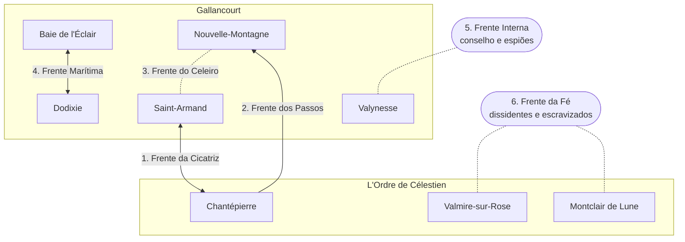

---
tags:
  - Campanha
---

# Forças e frentes

!!! warning "`POSSIBILIDADE`"
    Proposta de campanha, não cânone.

## Comparação das forças

A base vem do [equilíbrio atual](../eventos/guerra-fria.md) registrado no cânone.

| | Gallancourt (Aliança dos Lordes) | L'Ordre de Célestien |
|---|---|---|
| **Força principal** | Marinha, grão, dinheiro, magia, fortalezas | Unidade religiosa, comando único, fervor |
| **Fraqueza principal** | Cinco casas que não confiam umas nas outras | Depende de um único homem, Marceau; território montanhoso e menos fértil |
| **Comando** | Conselho de cinco casas (lento, disputado) | Primat e seus tribunais (rápido, implacável) |
| **Informação** | Beaumont, Corbeau, Enry | Tribunais da doutrina e o que de la Rivière entregou |
| **Vantagem de terreno** | Mar, recifes, terras férteis | Montanhas, passos, posição defensiva |

## O plano de guerra de L'Ordre — "A Luz que Divide"

1. **Dividir** — incentivar as rivalidades da Aliança: golpe, dívidas, assassinatos.
2. **Esfomear** — sabotar Nouvelle-Montagne e cortar a ligação Roche–Saint-Laurent.
3. **Romper** — atravessar a cordilheira pelo passo revelado por de la Rivière, sem atacar
   Saint-Armand de frente.
4. **Retomar Valynesse** — cercar a cidade onde o primeiro Édito foi proclamado e proclamar ali
   o Segundo Édito.

## O plano da Aliança (se ela conseguir se unir)

1. **Segurar a fronteira** — Saint-Armand na Cicatriz, Juliette Clermont no abastecimento.
2. **Dominar o mar** — Dodixie e Baie de l'Éclair juntas, se superarem a rivalidade.
3. **Tempestade** — convencer [Kaelen Thorne](../personagens/kaelen-thorne.md) a usar a Torre do
   Trovão na guerra.
4. **Apodrecer por dentro** — explorar dissidentes da fé tradicional e não-humanos escravizados
   em L'Ordre.

## As seis frentes

| # | Frente | Onde | O que está em jogo | Aventuras típicas |
|---|---|---|---|---|
| 1 | **Frente da Cicatriz** | [A Cicatriz](../geografia/a-cicatriz.md), diante de [Saint-Armand](../cidades/saint-armand.md) | A linha principal; a memória da primeira guerra | Patrulhas, cercos, resgate de prisioneiros, combates em trincheiras |
| 2 | **Frente dos Passos** | [Cordilheira](../geografia/grande-cordilheira.md), a partir de [Chantépierre](../cidades/chantepierre.md) | O passo secreto de de la Rivière | Descobrir e fechar o passo, emboscadas na neve, sabotar pontes |
| 3 | **Frente do Celeiro** | [Nouvelle-Montagne](../cidades/nouvelle-montagne.md) | A comida da Aliança inteira | Proteger colheitas, caçar sabotadores, negociar com os clãs |
| 4 | **Frente Marítima** | Costas, [Ilhas do Relâmpago](../geografia/ilhas-do-relampago.md), águas orientais | Rotas, desembarques e a lealdade das [frotas](../faccoes/frotas-corsarias-e-piratas.md) | Batalhas navais, caça a piratas, escoltar comboios de grão |
| 5 | **Frente Interna** | [Valynesse](../cidades/valynesse.md) e o conselho da Aliança | A unidade política | Espionagem, contraespionagem, impedir o golpe, proteger alvos de assassinato |
| 6 | **Frente da Fé** | Dentro de L'Ordre ([Valmire-sur-Rose](../cidades/valmire-sur-rose.md), [Montclair de Lune](../cidades/montclair-de-lune.md)) | A legitimidade de Marceau | Infiltração, contato com dissidentes, libertação de escravizados |

## A questão do mar

O mapa de L'Ordre mostra corpos d'água ao norte e ao sul do território oriental. L'Ordre não tem
marinha conhecida, o que torna o mar a maior vantagem da Aliança, a menos que L'Ordre **compre
uma frota**.

!!! abstract "Reviravolta sugerida"
    A frota pirata financiada por [Lucien de Saint-Pierre](../personagens/lucien-de-saint-pierre.md)
    é, em última instância, paga com ouro de L'Ordre. Élodie Vaucluse acha que Lucien trabalha
    para ela; Lucien trabalha para quem paga mais. Quando a guerra começa, a frota "pirata" vira a
    marinha de L'Ordre.
