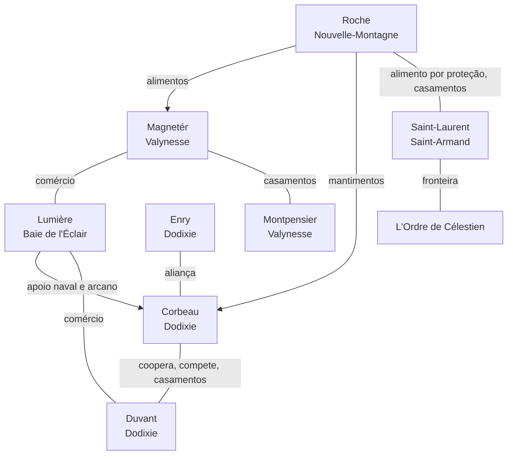

---
tags:
  - Compêndio
  - Facções
---

# Política e facções — Compêndio

Os dois Estados nascidos da guerra, as casas que os sustentam, as organizações, as frotas, a teia
de dependências entre elas e a economia que amarra tudo.

!!! info "Fontes desta página"
    V2 pp. 1–8; V2-r pp. 11–15; V1 §I–II e V; dossiê XIII–XIV, XXV–XXVII, 1, 3, 4 e 6.

---

## Aliança dos Lordes

| | |
|---|---|
| **Tipo** | Aristocracia compartilhada |
| **Estado** | Gallancourt (o oeste) |
| **Órgão de governo** | Conseil des Seigneurs |
| **Origem** | Fraternidade dos Cinco Sangues |
| **Cidades** | Valynesse (capital), Dodixie, Baie de l'Éclair, Saint-Armand, Nouvelle-Montagne |
| **Rival** | L'Ordre de Célestien |

Depois da execução da família real, as cinco casas não criaram uma nova monarquia: transformaram a
Fraternidade numa **aristocracia reconhecida**, com poder territorial e partilhado, e as cidades do
oeste se ergueram com autonomia e responsabilidade V1. O Estado ocidental conservou o nome
de **Gallancourt** — às vezes chamado de Aristocracia de Gallancourt.

A Aliança não é uma sociedade sem conflitos ou injustiças: é o bloco que derrubou a monarquia e
adotou uma aristocracia compartilhada. A guerra civil acabou; a guerra política apenas começou.

### O Conseil des Seigneurs

Após a trégua da guerra civil, o governo passou ao **Conseil des Seigneurs** (Conselho dos
Lordes), onde **os duques das cinco grandes cidades** tomam as decisões mais importantes. O
Conselho foi criado para dividir o poder entre as cidades e impedir uma nova guerra civil.

Essa estrutura interrompeu as guerras internas, mas o equilíbrio continua instável: cada cidade
busca expandir sua influência por meio de intrigas, manipulações e acordos secretos. Os conflitos
internos, as ambições pessoais e as traições constantes ameaçam desestabilizar Gallancourt.

!!! question "Em aberto"
    - Quem é o "duque" de cada cidade no Conselho, já que os líderes usam títulos diferentes
      (Doge, Marquesa, Duque, Lorde Comandante, Senhora do Pico)?
    - Como vota o Conselho? Qual é sua sede? Quem controla impostos e justiça?
    - O Doge Magnetér é primeiro entre iguais, chefe executivo ou só governante de Valynesse?
    - Como se resolvem disputas entre casas? Cidades menores têm representação?

### Os cinco pilares

| Casa | Cidade | Pilar | Figura central |
|---|---|---|---|
| **Magnetér** | Valynesse | Política, finanças e informação | Doge Lorenzo Magnetér |
| **Corbeau** | Dodixie | Poder marítimo e comercial do norte | Marquesa Scyras |
| **Lumière** | Baie de l'Éclair | Poder marítimo e arcano do oeste | Duque Jeanesse Lumière |
| **Saint-Laurent** | Saint-Armand | Poder militar e fronteira | Lorde Comandante Armand Saint-Laurent |
| **Roche** | Nouvelle-Montagne | Abastecimento | Senhora do Pico Helga Roche |

Nenhuma casa é inteiramente independente. Se uma falhar, as outras quatro são afetadas.

!!! abstract "Inferência funcional"
    Sem os alimentos de Nouvelle-Montagne, cidades e exércitos passam fome; sem Saint-Armand, a
    fronteira fica vulnerável; sem os portos de Dodixie e Baie de l'Éclair, o comércio e a marinha
    enfraquecem; sem as finanças e as redes de Valynesse, a coordenação política se perde; sem a
    Torre do Trovão e a construção naval, Baie de l'Éclair perde sua singularidade.

### As cinco casas

**Magnetér (Valynesse).** Família centenária. Controla informações e finanças e manipula o título
de Doge; é o polo central que equilibra — ou manipula — as outras quatro famílias V1. Está
associada à transformação do poder monárquico em governo aristocrático compartilhado. Em seu círculo:
Beaumont, Montpensier e du Valois.

**Corbeau (Dodixie).** A maior família de Dodixie; naval e mercante. Scyras transformou a revolta
contra a traição que matou seu pai numa campanha política. Hoje busca reerguer o poder da família e
fazer de Dodixie a capital, apoiando-se em Roche para os mantimentos e em Lumière para o apoio naval
e arcano V1. Seu acordo clandestino com Rochefort lhe permite agir sem responsabilidade
pública — e a liga a um corsário com interesses próprios.

**Lumière (Baie de l'Éclair).** Construiu sua influência por meio de estaleiros e do patrocínio à
Torre do Trovão V1. Intermedeia nobreza, comércio e magia; oferece suporte mágico e
marítimo à Aliança e tem laços comerciais com Magnetér e Duvant V1. A autonomia da Torre,
de Vigny e da guilda impede que sua influência seja confundida com controle da cidade.

**Saint-Laurent (Saint-Armand).** O braço militar da Aliança: guarda a fronteira e fornece o
"músculo" V1. Fiel ao Amaunator tradicional. Sua indispensabilidade é também risco
político — Valynesse teme um golpe, e com razão `SEGREDO`.

**Roche (Nouvelle-Montagne).** Também chamada Clã Roche, o mais antigo e poderoso da região. Sua
comida é moeda estratégica V1. Mantém laços de dependência com Valynesse (fornecimento) e
acordos militares com Saint-Armand (defesa) V1.

### Outras casas

| Casa | Cidade | O que se sabe |
|---|---|---|
| **D'Aubren** | Valynesse | Antiga casa real; extinta com a execução de Thibault, Isabeau, Louis, Clarisse e Marcel |
| **Duvant** | Dodixie | Segunda família de Dodixie, liderada pelo Marquês Alaric. Coopera e compete com Corbeau; domina a península oeste e o forte oeste; tem frota privada e milícias costeiras; quer fazer de Dodixie a capital sob sua liderança V1 |
| **Enry** | Dodixie | Nobres treinados nas artes ladina e psiônica há gerações; assassinos e manipuladores secretos. Próximos de Corbeau e, depois do massacre, alinhados a ela V1 |
| **Montpensier** | Valynesse | Família da Baronesa Amélie; fortuna erguida com crueldade no cartel de mineração. Ligada aos Magnetér por alianças e casamentos V1 |
| **Beaumont** | Valynesse | Família do Mestre dos Sussurros; perdeu quase todo o poder militar na guerra e o reconstruiu com informação |
| **Rochefort** | Baie de l'Éclair | Linhagem nobre arruinada por Jean Vigny |
| **Brissac, du Valois, Montaigne, Vaucluse, Saint-Pierre, Clermont, de la Rivière, de Montclair** | Várias | Famílias dos nobres citados; nada se sabe delas como casas |

### Casamentos e alianças

Segundo a V1, **alianças e casamentos** entre casas definem tratados temporários e campos de
lealdade V1:

- **Duvant / Corbeau**;
- **Magnetér / Montpensier**;
- **Roche / Saint-Laurent**.

!!! question "Em aberto"
    Quem se casou com quem, e quando?

---

## A Fraternidade dos Cinco Sangues

*La Fraternité des Cinq Sangues*, depois chamada politicamente de **Aliança Rebelde**. Nasceu nos
meses seguintes ao Édito V1, numa reunião secreta das cinco maiores famílias das cidades do
oeste, do desespero e da fúria do Ano de Sangue. Coordenou a resistência durante os pouco mais de
três anos de guerra, com forte apoio popular no oeste e no centro, e transformou-se na Aliança dos
Lordes após a queda de Valynesse.

---

## L'Ordre de Célestien

| | |
|---|---|
| **Tipo** | Teocracia |
| **Fundador e líder** | Primat Severin Marceau |
| **Capital** | Montclair de Lune |
| **Outras cidades** | Valmire-sur-Rose, Chantépierre |
| **Território** | O leste, além da cordilheira |
| **Doutrina** | A pureza: radicalização do culto de Amaunator |

Encurraladas no fim da guerra, a Monarquia e a Igreja executaram um êxodo estratégico para o leste,
onde a população humana e tradicionalista lhes era simpática. Severin Marceau levou clérigos,
nobres e seguidores; o alto clero se reorganizou e aproveitou o vácuo político V1. Nasceu
uma teocracia onde os clérigos de Amaunator finalmente tomaram o poder absoluto. A nova liturgia do
sol foi institucionalizada, e a intolerância, solidificada em lei V1.

Nas décadas seguintes, L'Ordre consolidou suas doutrinas e instituições religiosas e militares e
**expandiu sua influência religiosa** V1.

| As cidades | Papel |
|---|---|
| Montclair de Lune | Capital; tribunais religiosos e políticas de purificação |
| Valmire-sur-Rose | Vassala ideológica; templos e escolas |
| Chantépierre | Patrulha e vigia as fronteiras culturais e religiosas |

**Forças:** unidade religiosa, autoridade teocrática, território oriental consolidado, controle das
cidades da nova doutrina e liderança centralizada em Marceau.

!!! warning "SEGREDO"
    L'Ordre converteu o Capitão-General Thibault de la Rivière, comandante da Patrulha da Fronteira
    de Saint-Armand, e com a informação dele massacrou a família Enry perto de Dodixie.

!!! question "Em aberto"
    Cargos e tribunais (a V1 propõe um "Tribunal do Sol" `POSSIBILIDADE`), conselho de governo,
    hierarquia clerical, forças armadas, sucessão, dissidentes internos.

---

## Organizações

| Organização | Cidade | Líder | O que é |
|---|---|---|---|
| **Magocracia da Torre do Trovão** | Baie de l'Éclair | Arquimago Elian Lumière | Centro de poder arcano; magia das tempestades; uma das maiores bibliotecas arcanas do reino. Dependência mútua com os comerciantes V1 |
| **Guilda dos construtores navais** | Baie de l'Éclair | Mestre Louis de Montclair | Produz as melhores embarcações do reino |
| **La Voile Noire** | Dodixie | Zepharion (atribuído) | Rede criminosa das docas; instrumento político e econômico de algumas casas V1 |
| **Patrulha da Fronteira** | Saint-Armand | Capitão-General Thibault de la Rivière | Vigia a fronteira com L'Ordre |
| **Rede de Beaumont** | Valynesse | Conde Philippe Beaumont | Espionagem em todo o reino |
| **Clero de Amaunator (Igreja)** | Leste | Primat Severin Marceau | Hoje, o governo de L'Ordre |

## Frotas e piratas

As fontes citam **quatro grupos distintos**, que não devem ser fundidos sem confirmação:

| # | Frota | Patrono | Alvo | Situação |
|---|---|---|---|---|
| 1 | Frota corsária lealista, sob "um grande corsário lealista" V1 | A Coroa | Dodixie | Destruída na Queda das Velas Negras (mais de 200 navios) |
| 2 | Frota de Étienne Rochefort | Scyras Corbeau, em segredo | Navios de Vigny (e às vezes de Dodixie) | Ativa |
| 3 | Frota pirata rival | Lucien de Saint-Pierre, com a própria fortuna | Navios de Baie de l'Éclair | Ativa |
| 4 | Piratas Fishmen (humanoides-peixe) | Desconhecido | Região de Dodixie | Ativos |

Além delas: corsários **controlados por nobres de Baie de l'Éclair** V2-r, a **frota privada
e as milícias costeiras de Alaric Duvant** V1, e a pirataria nas **Ilhas do Relâmpago**
(chamadas de "Ilhas do Trovão" na V1 — mesmo arquipélago), que interrompeu rotas e estimulou
políticas navais V1.

---

## A teia de conexões

### Fluxos e dependências V1

- **Comércio marítimo:** Dodixie ↔ Baie de l'Éclair (rotas e influência arcana).
- **Alimento e logística:** Nouvelle-Montagne → Valynesse; Saint-Armand protege os caminhos
  terrestres e recebe provisões em troca de defesa.
- **Informação e espionagem:** Valynesse (Beaumont) ↔ Dodixie (Scyras e os Enry) ↔ Baie de
  l'Éclair (Rochefort) — uma rede de intrigas que manipula acordos políticos.
- **Casamentos:** Duvant/Corbeau, Magnetér/Montpensier, Roche/Saint-Laurent.

### Relações bilaterais

| Par | Natureza |
|---|---|
| Corbeau × Duvant | Cooperação e competição |
| Corbeau × Rochefort | Clandestina `SEGREDO` |
| Vigny × Montclair | Simbiose e desprezo |
| Rochefort × Vigny | Vingança |
| Roche × Saint-Laurent | Dependência estratégica: alimento por proteção |
| Armand × Juliette | Conspiração e contraconspiração `SEGREDO` |
| Vaucluse × Brissac | Correspondência secreta `SEGREDO` |
| Magnetér × Beaumont | Interesse direto; subordinação não confirmada |
| Aliança × L'Ordre | A grande divisão: religião, raça, legitimidade, poder e memória da guerra |

As intrigas completas, com marcas `CANON`/`POSSIBILIDADE`, estão em
[Intrigas da nobreza](../mundo/intrigas-da-nobreza.md).

---

## Economia política

A economia de Gallancourt é regionalmente especializada; nenhuma cidade é autossuficiente.

| Cidade | Base econômica | Consequência política |
|---|---|---|
| Valynesse | Minas exclusivas de metais e gemas, joalheria, tecidos finos, artesãos, frutas nobres, especiarias, carne; comércio terrestre e finanças | Centralidade política; cobra tributos de Nouvelle-Montagne; depende em parte do sul para comer V1 |
| Dodixie | A mais rica: madeira, navios, vinho, carvão, florestas, recursos da cordilheira, comércio marítimo | Desafia a capital; centralidade econômica no pós-guerra V1 |
| Baie de l'Éclair | Maior porto, melhores navios, pesca, pérolas, madeira costeira, energia arcana | Controla o frete e as rotas; influência sobre a marinha |
| Nouvelle-Montagne | Grãos, pomares, gado, vinhos, especiarias, mármore, argila, artesanato, culinária | Poder de abastecimento; explorada por tributos e fretes |
| Saint-Armand | Exército de elite, armamento, pedreiras, ferro | Controla a segurança; depende de comida externa |
| L'Ordre | Governo teocrático, instituições religiosas, administração | Poder centralizado e doutrinário |

**Taxas e explorações:** Valynesse cobra tributos abusivos sobre os alimentos de Nouvelle-Montagne;
Baie de l'Éclair (as taxas de Vigny) extorque o frete de grãos e animais; Valynesse e Baie disputam
as taxas marítimas; os fazendeiros preferem vender a Dodixie para fugir das taxas da capital.

**Instrumentos de pressão:** embargos, bloqueios navais, pirataria patrocinada, crédito e leilões
(o Leilão de Cristal e o Leilão Real).

!!! question "Em aberto"
    Moeda, impostos, bancos e crédito, propriedade das minas e das terras, sistema de guildas.
    Como a escravidão instituída pelo Édito foi tratada na Aliança depois da guerra? Como vivem hoje
    os não-humanos?

## Veja também

Na wiki: [Aliança dos Lordes](../faccoes/alianca-dos-lordes.md) ·
[L'Ordre de Célestien](../faccoes/l-ordre-de-celestien.md) ·
[Teia política](../mundo/teia-politica.md) · [Economia](../mundo/economia.md) ·
[Operações clandestinas](../mundo/operacoes-clandestinas.md)
