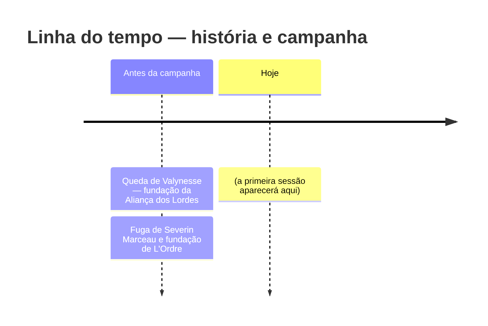

---
tags:
  - Diário
  - Mestre
---

# Diário de Sessões

O registro de cada sessão jogada: o que aconteceu, quais páginas da wiki mudaram por causa disso,
e as duas datas de cada evento — a **data real** (quando a sessão foi jogada) e a **data na
campanha**, no [calendário de Gallancourt](../mundo/calendario.md).

Este é o único lugar da wiki que se atualiza toda semana. O resto — cidades, personagens, facções —
só muda quando alguma coisa aqui embaixo pedir uma mudança lá.

!!! tip "Data real de cada página"
    Você não precisa anotar à mão quando editou uma página: todo rodapé de página mostra sozinho
    a data da última edição (e a data de criação), tiradas direto do histórico do git. Isso só
    funciona **depois de commitado** — enquanto uma mudança não é commitada, a data mostrada é a de
    hoje.

## Registrar uma sessão pelo Painel do Mestre

A forma mais prática de registrar uma sessão é o **[Painel do Mestre](../mestre/painel.md)**: um
formulário local onde você marca os NPCs e os lugares envolvidos, escreve o que aconteceu e clica
em aplicar. Ele cria a página da sessão, atualiza a tabela e a linha do tempo abaixo, cola um
registro no rodapé de cada NPC e cidade escolhidos, e ajusta o menu do site — tudo de uma vez, sem
precisar editar nenhum arquivo à mão. O painel também tem uma aba para editar qualquer página do
site direto pelo navegador.

## Sessões registradas

<!-- inicio:sessoes -->
| Sessão | Data real | Data na campanha | Resumo |
|---|---|---|---|
| — | — | — | Nenhuma sessão registrada ainda. Use o [Painel do Mestre](../mestre/painel.md) para criar a primeira. |
<!-- fim:sessoes -->

## Linha do tempo

<!-- inicio:timeline -->

<!-- fim:timeline -->

## Como funciona por baixo dos panos

Se preferir registrar uma sessão à mão (ou entender o que o Painel do Mestre está fazendo por
você), o modelo de página de sessão e o passo a passo completo estão em
[Como registrar uma sessão manualmente](../mestre/registro-manual-de-sessao.md).
