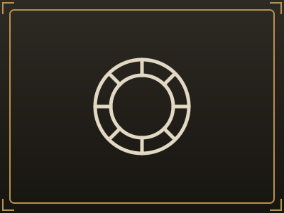

---
tags:
  - Facções
---

# Facções

## Estados e alianças

-   [{ .card-portrait }](alianca-dos-lordes.md)

    **[Aliança dos Lordes](alianca-dos-lordes.md)**

    Aristocracia compartilhada. Oeste, centro político em [Valynesse](../cidades/valynesse.md).
    Liderada pelas cinco casas.

-   [{ .card-portrait }](l-ordre-de-celestien.md)

    **[L'Ordre de Célestien](l-ordre-de-celestien.md)**

    Teocracia. Sede em [Montclair de Lune](../cidades/montclair-de-lune.md), liderada por
    [Severin Marceau](../personagens/severin-marceau.md).

-   [{ .card-portrait }](fraternidade-dos-cinco-sangues.md)

    **[Fraternidade dos Cinco Sangues](fraternidade-dos-cinco-sangues.md)**

    Aliança rebelde histórica. As cinco casas, unidas contra o Édito da Pureza.

## As cinco casas da Fraternidade

-   [{ .card-portrait }](casa-magneter.md)

    **[Magnetér](casa-magneter.md)**

    [Valynesse](../cidades/valynesse.md). Finanças, administração, informação. Figura central:
    [Lorenzo Magnetér](../personagens/lorenzo-magneter.md).

-   [{ .card-portrait }](casa-corbeau.md)

    **[Corbeau](casa-corbeau.md)**

    [Dodixie](../cidades/dodixie.md). Marinha, comércio, espionagem. Figura central:
    [Scyras Corbeau](../personagens/scyras-corbeau.md).

-   [{ .card-portrait }](casa-lumiere.md)

    **[Lumière](casa-lumiere.md)**

    [Baie de l'Éclair](../cidades/baie-de-l-eclair.md). Comércio marítimo, construção naval,
    magia. Figura central: [Jeanesse Lumière](../personagens/jeanesse-lumiere.md).

-   [{ .card-portrait }](casa-saint-laurent.md)

    **[Saint-Laurent](casa-saint-laurent.md)**

    [Saint-Armand](../cidades/saint-armand.md). Exército, fortalezas, fronteira. Figura central:
    [Armand Saint-Laurent](../personagens/armand-saint-laurent.md).

-   [{ .card-portrait }](casa-roche.md)

    **[Roche](casa-roche.md)**

    [Nouvelle-Montagne](../cidades/nouvelle-montagne.md). Agricultura, alimentos, recursos.
    Figura central: [Helga Roche](../personagens/helga-roche.md).

## Outras casas

-   [{ .card-portrait }](casa-d-aubren.md)

    **[D'Aubren](casa-d-aubren.md)**

    [Valynesse](../cidades/valynesse.md). Antiga casa real; executada na queda da capital.

-   [{ .card-portrait }](casa-duvant.md)

    **[Duvant](casa-duvant.md)**

    [Dodixie](../cidades/dodixie.md). Segunda grande família da cidade; coopera e compete com
    Corbeau.

## Organizações

-   [{ .card-portrait }](torre-do-trovao.md)

    **[Torre do Trovão](torre-do-trovao.md)**

    Magocracia / instituição arcana em [Baie de l'Éclair](../cidades/baie-de-l-eclair.md).

-   [{ .card-portrait }](guilda-dos-construtores-navais.md)

    **[Guilda dos Construtores Navais](guilda-dos-construtores-navais.md)**

    Guilda de [Baie de l'Éclair](../cidades/baie-de-l-eclair.md).

-   [{ .card-portrait }](la-voile-noire.md)

    **[La Voile Noire](la-voile-noire.md)**

    Rede criminosa de [Dodixie](../cidades/dodixie.md).

-   [{ .card-portrait }](frotas-corsarias-e-piratas.md)

    **[Frotas corsárias e piratas](frotas-corsarias-e-piratas.md)**

    Três frotas distintas, espalhadas pelo mar.

