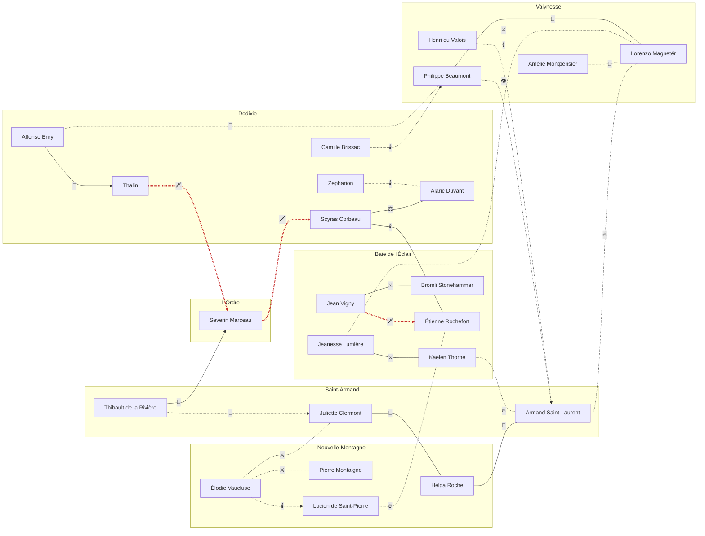

---
tags:
  - Mundo
  - Política
  - Personagens
---

# Intrigas da nobreza

Quem é aliado de quem, quem vigia quem e quem quer quem morto. Relações marcadas `CANON` vêm do
dossiê; as marcadas `POSSIBILIDADE` são propostas para dar à campanha alianças, rivalidades e
conspirações de assassinato. `SEGREDO` indica o que os personagens do mundo, em geral, não sabem.

## Legenda

| Tipo | Ícone |
|---|---|
| Aliança | 🤝 |
| Cooperação e rivalidade | ⚖️ |
| Rivalidade | ⚔️ |
| Hostilidade | 🔥 |
| Conspiração de assassinato | 🗡️ |
| Clandestina | 🕯️ |
| Vigilância | 👁️ |
| Mentor | 📜 |
| Traição | 🐍 |
| Dependência | 🔗 |

## Mapa de intrigas

!!! tip "Leitura do diagrama"
    Linhas cheias são cânone; linhas tracejadas são possibilidades. Setas indicam relações de mão
    única (quem conspira contra quem, quem vigia quem).

## Conspirações de assassinato

- 🗡️ **[Jean Vigny](../personagens/jean-vigny.md) → [Étienne Rochefort](../personagens/etienne-rochefort.md)** `POSSIBILIDADE` `SEGREDO`: Os ataques de Rochefort afundam as cargas de Vigny. O comodoro contratou La Voile Noire para matá-lo, sem saber que o corsário trabalha para Scyras.
- 🗡️ **[Severin Marceau](../personagens/severin-marceau.md) → [Scyras Corbeau](../personagens/scyras-corbeau.md)** `POSSIBILIDADE` `SEGREDO`: Para L'Ordre, a frota de Dodixie é o maior obstáculo a uma nova guerra. Matar a duquesa antes da invasão deixaria a marinha do norte sem cabeça.
- 🗡️ **[Thalin](../personagens/thalin.md) → [Severin Marceau](../personagens/severin-marceau.md)** `POSSIBILIDADE` `SEGREDO`: A vingança de Thalin tem um alvo: o homem cuja doutrina matou sua gente. Um assassinato fracassado do Primat poderia servir de pretexto para a guerra.

## Todas as relações

| De | | Para | Tipo | Marca | Descrição |
|---|---|---|---|---|---|
| [Scyras Corbeau](../personagens/scyras-corbeau.md) | ↔ | [Alaric Duvant](../personagens/alaric-duvant.md) | ⚖️ Cooperação e rivalidade | `CANON` | Duvant reconhece a liderança de Corbeau, mas tem ambições próprias em Dodixie. |
| [Scyras Corbeau](../personagens/scyras-corbeau.md) | ↔ | [Étienne Rochefort](../personagens/etienne-rochefort.md) | 🕯️ Clandestina | `CANON` `SEGREDO` | Acordo secreto: o corsário ataca inimigos da casa e obtém seus próprios ganhos. |
| [Jean Vigny](../personagens/jean-vigny.md) | ↔ | [Bromli Stonehammer](../personagens/bromli-stonehammer.md) | ⚔️ Rivalidade | `CANON` | A guilda naval depende do comércio de Vigny, mas teme virar instrumento de seu monopólio. |
| [Helga Roche](../personagens/helga-roche.md) | ↔ | [Armand Saint-Laurent](../personagens/armand-saint-laurent.md) | 🔗 Dependência | `CANON` | Alimento em troca de proteção, desde o Massacre da Aurora Velada. |
| [Juliette Clermont](../personagens/juliette-clermont.md) | ↔ | [Helga Roche](../personagens/helga-roche.md) | 🤝 Aliança | `CANON` | Juliette é a ponte logística e uma voz de equilíbrio entre Saint-Armand e Nouvelle-Montagne. |
| [Lorenzo Magnetér](../personagens/lorenzo-magneter.md) | ↔ | [Philippe Beaumont](../personagens/philippe-beaumont.md) | 🤝 Aliança | `CANON` | A Casa Magnetér tem interesse direto nas redes do Mestre dos Sussurros; a subordinação formal não é confirmada. |
| [Alfonse Enry](../personagens/alfonse-enry.md) | → | [Thalin](../personagens/thalin.md) | 📜 Mentor | `CANON` | Enry treinou Thalin nas artes da resistência. |
| [Thibault de la Rivière](../personagens/thibault-de-la-riviere.md) | → | [Severin Marceau](../personagens/severin-marceau.md) | 🐍 Traição | `CANON` | Passou informações estratégicas da Aliança a L'Ordre e se ofereceu a ele. |
| [Jeanesse Lumière](../personagens/jeanesse-lumiere.md) | ↔ | [Kaelen Thorne](../personagens/kaelen-thorne.md) | ⚔️ Rivalidade | `CANON` | A aristocracia Lumière contra a autonomia da Torre do Trovão. |
| [Jean Vigny](../personagens/jean-vigny.md) | → | [Étienne Rochefort](../personagens/etienne-rochefort.md) | 🗡️ Conspiração de assassinato | `POSSIBILIDADE` `SEGREDO` | Os ataques de Rochefort afundam as cargas de Vigny. O comodoro contratou La Voile Noire para matá-lo, sem saber que o corsário trabalha para Scyras. |
| [Severin Marceau](../personagens/severin-marceau.md) | → | [Scyras Corbeau](../personagens/scyras-corbeau.md) | 🗡️ Conspiração de assassinato | `POSSIBILIDADE` `SEGREDO` | Para L'Ordre, a frota de Dodixie é o maior obstáculo a uma nova guerra. Matar a duquesa antes da invasão deixaria a marinha do norte sem cabeça. |
| [Thalin](../personagens/thalin.md) | → | [Severin Marceau](../personagens/severin-marceau.md) | 🗡️ Conspiração de assassinato | `POSSIBILIDADE` `SEGREDO` | A vingança de Thalin tem um alvo: o homem cuja doutrina matou sua gente. Um assassinato fracassado do Primat poderia servir de pretexto para a guerra. |
| [Armand Saint-Laurent](../personagens/armand-saint-laurent.md) | ↔ | [Lorenzo Magnetér](../personagens/lorenzo-magneter.md) | 🔥 Hostilidade | `POSSIBILIDADE` | Armand acha que o Doge governa como um rei sem coroa; Lorenzo teme o exército. O golpe que Armand considerou teria Valynesse como alvo. |
| [Philippe Beaumont](../personagens/philippe-beaumont.md) | → | [Armand Saint-Laurent](../personagens/armand-saint-laurent.md) | 👁️ Vigilância | `POSSIBILIDADE` `SEGREDO` | Beaumont sabe dos planos de golpe e guarda a informação como moeda de troca, sem contá-la nem ao Doge. |
| [Henri du Valois](../personagens/henri-du-valois.md) | → | [Armand Saint-Laurent](../personagens/armand-saint-laurent.md) | 🕯️ Clandestina | `POSSIBILIDADE` `SEGREDO` | Os "movimentos políticos" que Henri financia incluem o golpe de Armand. Alternativa: Henri financia simpatizantes da doutrina da pureza dentro da Aliança. |
| [Élodie Vaucluse](../personagens/elodie-vaucluse.md) | → | [Lucien de Saint-Pierre](../personagens/lucien-de-saint-pierre.md) | 🕯️ Clandestina | `POSSIBILIDADE` `SEGREDO` | Élodie é a patrona oculta de Lucien: a frota pirata rival é o braço naval de sua política de usar o grão como arma. |
| [Lucien de Saint-Pierre](../personagens/lucien-de-saint-pierre.md) | ↔ | [Étienne Rochefort](../personagens/etienne-rochefort.md) | 🔥 Hostilidade | `POSSIBILIDADE` | A frota "rival" é rival de Rochefort: as duas disputam as mesmas presas. |
| [Zepharion](../personagens/zepharion.md) | ↔ | [Alaric Duvant](../personagens/alaric-duvant.md) | 🕯️ Clandestina | `POSSIBILIDADE` `SEGREDO` | Duvant usa La Voile Noire para desgastar os negócios de Corbeau sem sujar as próprias mãos. |
| [Camille Brissac](../personagens/camille-brissac.md) | → | [Philippe Beaumont](../personagens/philippe-beaumont.md) | 🕯️ Clandestina | `POSSIBILIDADE` `SEGREDO` | A condessa é a agente de Beaumont em Dodixie: seus negócios são cobertura para uma rede de informantes. |
| [Élodie Vaucluse](../personagens/elodie-vaucluse.md) | ↔ | [Pierre Montaigne](../personagens/pierre-montaigne.md) | ⚔️ Rivalidade | `POSSIBILIDADE` | Élodie quer usar o grão como arma política; Montaigne prefere vender e prosperar. Disputam o voto do conselho de chefes. |
| [Élodie Vaucluse](../personagens/elodie-vaucluse.md) | ↔ | [Juliette Clermont](../personagens/juliette-clermont.md) | ⚔️ Rivalidade | `POSSIBILIDADE` | As duas negociam todo ano o preço do grão para a fronteira. Respeito profissional, desconfiança pessoal. |
| [Amélie Montpensier](../personagens/amelie-montpensier.md) | ↔ | [Lorenzo Magnetér](../personagens/lorenzo-magneter.md) | 🤝 Aliança | `POSSIBILIDADE` | O poder do Doge depende do ouro das minas de Amélie; ela sabe disso e cobra caro. |
| [Kaelen Thorne](../personagens/kaelen-thorne.md) | ↔ | [Armand Saint-Laurent](../personagens/armand-saint-laurent.md) | 🔥 Hostilidade | `POSSIBILIDADE` | Armand quer a Torre como arma de guerra; Kaelen quer ser deixado em paz com suas tempestades. |
| [Thibault de la Rivière](../personagens/thibault-de-la-riviere.md) | → | [Juliette Clermont](../personagens/juliette-clermont.md) | 🐍 Traição | `POSSIBILIDADE` `SEGREDO` | De la Rivière deixou informantes em Saint-Armand. Juliette suspeita, mas não sabe quem são. |
| [Jeanesse Lumière](../personagens/jeanesse-lumiere.md) | ↔ | [Lorenzo Magnetér](../personagens/lorenzo-magneter.md) | ⚔️ Rivalidade | `POSSIBILIDADE` | Lumière teme ser reduzida a província do Doge e resiste a cada nova taxa de Valynesse. |
| [Alfonse Enry](../personagens/alfonse-enry.md) | ↔ | [Philippe Beaumont](../personagens/philippe-beaumont.md) | 🤝 Aliança | `POSSIBILIDADE` | Dois mestres da informação que trabalharam juntos na guerra. Um deles pode saber quem foi o nobre infiltrado de Valynesse. |

## Relações entre as casas

Resumo do tom entre as famílias, derivado das relações entre cidades e nobres.

| | Magnetér | Corbeau | Lumière | Saint-Laurent | Roche | Duvant |
|---|---|---|---|---|---|---|
| **[Magnetér](../faccoes/casa-magneter.md)** | — | 🟠 Tenso | 🔵 Cordial | 🔴 Hostil velado | 🟠 Tenso | ⚪ Cortejada por Duvant |
| **[Corbeau](../faccoes/casa-corbeau.md)** | 🟠 Tenso | — | 🟠 Tenso | ⚪ Neutro | 🔵 Cordial | ⚖️ Cooperação e rivalidade `CANON` |
| **[Lumière](../faccoes/casa-lumiere.md)** | 🔵 Cordial | 🟠 Tenso | — | 🟠 Tenso | ⚪ Neutro | ⚪ Neutro |
| **[Saint-Laurent](../faccoes/casa-saint-laurent.md)** | 🔴 Hostil velado | ⚪ Neutro | 🟠 Tenso | — | 🟢 Aliado `CANON` | ⚪ Neutro |
| **[Roche](../faccoes/casa-roche.md)** | 🟠 Tenso | 🔵 Cordial | ⚪ Neutro | 🟢 Aliado `CANON` | — | ⚪ Neutro |
| **[Duvant](../faccoes/casa-duvant.md)** | ⚪ Corteja Magnetér | ⚖️ Cooperação e rivalidade `CANON` | ⚪ Neutro | ⚪ Neutro | ⚪ Neutro | — |

!!! question "Em aberto"
    Cada `POSSIBILIDADE` acima é uma escolha do autor. Ao confirmar uma delas, troque a marca por
    `CANON` (ou `PLANEJADO`) aqui e na página do personagem.
