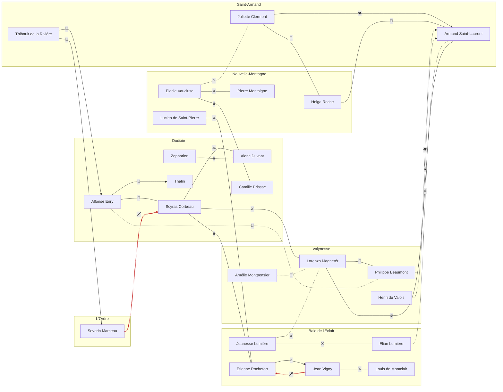

---
tags:
  - Mundo
  - Política
  - Personagens
---

# Intrigas da nobreza

Quem é aliado de quem, quem vigia quem e quem quer quem morto. Relações `CANON` vêm das fontes
(dossiê e *História de Gallancourt*); relações `POSSIBILIDADE` são propostas para o autor aprovar
ou descartar. `SEGREDO` indica o que os personagens do mundo, em geral, não sabem.

## Legenda

| Tipo | Ícone |
|---|---|
| Aliança | 🤝 |
| Cooperação e rivalidade | ⚖️ |
| Rivalidade | ⚔️ |
| Hostilidade | 🔥 |
| Conspiração de assassinato | 🗡️ |
| Clandestina | 🕯️ |
| Vigilância | 👁️ |
| Mentor | 📜 |
| Traição | 🐍 |
| Dependência | 🔗 |

## Mapa de intrigas

!!! tip "Leitura do diagrama"
    Linhas cheias são cânone; linhas tracejadas são possibilidades. Setas indicam relações de mão
    única. Linhas vermelhas são conspirações de assassinato.

## Segredos em jogo

- 🕯️ **[Scyras Corbeau](../personagens/scyras-corbeau.md) ↔ [Étienne Rochefort](../personagens/etienne-rochefort.md)** `CANON` `SEGREDO`: Scyras paga Rochefort com ouro e inteligência; ele ataca os navios de Vigny e, às vezes, os de Dodixie, para manter as aparências.
- 👁️ **[Juliette Clermont](../personagens/juliette-clermont.md) → [Armand Saint-Laurent](../personagens/armand-saint-laurent.md)** `CANON` `SEGREDO`: Ciente das ambições de Armand, Juliette trabalha sutilmente para frustrar o golpe, temendo uma nova guerra civil.
- 🐍 **[Thibault de la Rivière](../personagens/thibault-de-la-riviere.md) → [Severin Marceau](../personagens/severin-marceau.md)** `CANON` `SEGREDO`: Capturado em missão, aceitou poder e riqueza num "novo Gallancourt" purificado. Vaza informações, sabota patrulhas e fomenta desconfiança entre as cidades.
- 🐍 **[Thibault de la Rivière](../personagens/thibault-de-la-riviere.md) → [Alfonse Enry](../personagens/alfonse-enry.md)** `CANON` `SEGREDO`: Entregou a L'Ordre a localização da mansão do irmão de Alfonse, massacrado com quase toda a família.
- 🕯️ **[Élodie Vaucluse](../personagens/elodie-vaucluse.md) ↔ [Camille Brissac](../personagens/camille-brissac.md)** `CANON` `SEGREDO`: Correspondência secreta entre a líder radical de Nouvelle-Montagne e a face pública da campanha de Dodixie pela capital.
- 🗡️ **[Jean Vigny](../personagens/jean-vigny.md) → [Étienne Rochefort](../personagens/etienne-rochefort.md)** `POSSIBILIDADE` `SEGREDO`: O Comodoro, que governa pelo medo, contratou La Voile Noire para matar o corsário, sem saber que ele trabalha para Scyras.
- 🗡️ **[Severin Marceau](../personagens/severin-marceau.md) → [Scyras Corbeau](../personagens/scyras-corbeau.md)** `POSSIBILIDADE` `SEGREDO`: Para L'Ordre, a frota de Dodixie é o maior poder naval inimigo. Matar a marquesa deixaria a marinha do norte sem cabeça.
- 👁️ **[Philippe Beaumont](../personagens/philippe-beaumont.md) → [Armand Saint-Laurent](../personagens/armand-saint-laurent.md)** `POSSIBILIDADE` `SEGREDO`: Beaumont, que sabe de quase todas as conspirações, conhece os planos de golpe e guarda a informação como moeda de troca.
- 🕯️ **[Henri du Valois](../personagens/henri-du-valois.md) → [Armand Saint-Laurent](../personagens/armand-saint-laurent.md)** `POSSIBILIDADE` `SEGREDO`: Henri, que financia movimentos contra a opressão da elite, vê no golpe de Armand uma forma de derrubar a aristocracia corrupta.
- 🕯️ **[Zepharion](../personagens/zepharion.md) ↔ [Alaric Duvant](../personagens/alaric-duvant.md)** `POSSIBILIDADE` `SEGREDO`: Duvant usa La Voile Noire para desgastar os negócios de Corbeau sem sujar as próprias mãos.

## Todas as relações

| De | | Para | Tipo | Marca | Descrição |
|---|---|---|---|---|---|
| [Scyras Corbeau](../personagens/scyras-corbeau.md) | ↔ | [Alaric Duvant](../personagens/alaric-duvant.md) | ⚖️ Cooperação e rivalidade | `CANON` | Duvant reconhece a liderança de Corbeau, mas tem ambições próprias em Dodixie. |
| [Scyras Corbeau](../personagens/scyras-corbeau.md) | ↔ | [Étienne Rochefort](../personagens/etienne-rochefort.md) | 🕯️ Clandestina | `CANON` `SEGREDO` | Scyras paga Rochefort com ouro e inteligência; ele ataca os navios de Vigny e, às vezes, os de Dodixie, para manter as aparências. |
| [Étienne Rochefort](../personagens/etienne-rochefort.md) | → | [Jean Vigny](../personagens/jean-vigny.md) | 🔥 Hostilidade | `CANON` | Vigny construiu sua frota sobre a ruína da linhagem de Rochefort. O corsário ataca seus navios para derrubá-lo e tomar seu lugar. |
| [Jean Vigny](../personagens/jean-vigny.md) | ↔ | [Louis de Montclair](../personagens/louis-de-montclair.md) | ⚔️ Rivalidade | `CANON` | Simbiose e desprezo: a imprudência de Vigny e os piratas garantem a demanda pelos navios de Louis, que despreza o Comodoro e busca em segredo outro patrono. |
| [Scyras Corbeau](../personagens/scyras-corbeau.md) | ↔ | [Lorenzo Magnetér](../personagens/lorenzo-magneter.md) | ⚔️ Rivalidade | `CANON` | Dodixie quer ser a capital; Valynesse resiste. Scyras quer quebrar a hegemonia da velha nobreza e vingar o pai, traído por aristocratas da capital. |
| [Armand Saint-Laurent](../personagens/armand-saint-laurent.md) | ↔ | [Lorenzo Magnetér](../personagens/lorenzo-magneter.md) | 🔥 Hostilidade | `CANON` | A capital teme uma tomada de poder; Armand acredita que só um governo militar pode salvar o reino da aristocracia corrupta. |
| [Juliette Clermont](../personagens/juliette-clermont.md) | → | [Armand Saint-Laurent](../personagens/armand-saint-laurent.md) | 👁️ Vigilância | `CANON` `SEGREDO` | Ciente das ambições de Armand, Juliette trabalha sutilmente para frustrar o golpe, temendo uma nova guerra civil. |
| [Helga Roche](../personagens/helga-roche.md) | ↔ | [Armand Saint-Laurent](../personagens/armand-saint-laurent.md) | 🔗 Dependência | `CANON` | Alimento em troca de proteção, desde o Massacre da Aurora Velada. |
| [Juliette Clermont](../personagens/juliette-clermont.md) | ↔ | [Helga Roche](../personagens/helga-roche.md) | 🤝 Aliança | `CANON` | Juliette mantém a relação vital entre Saint-Armand e Nouvelle-Montagne. |
| [Lorenzo Magnetér](../personagens/lorenzo-magneter.md) | ↔ | [Philippe Beaumont](../personagens/philippe-beaumont.md) | 🤝 Aliança | `CANON` | Beaumont usa seus segredos para garantir a primazia de Valynesse; a subordinação formal à Casa Magnetér não é confirmada. |
| [Alfonse Enry](../personagens/alfonse-enry.md) | → | [Thalin](../personagens/thalin.md) | 📜 Mentor | `CANON` | Alfonse treina e guia Thalin em sua jornada por vingança após o massacre dos Enry. |
| [Alfonse Enry](../personagens/alfonse-enry.md) | ↔ | [Scyras Corbeau](../personagens/scyras-corbeau.md) | 🤝 Aliança | `CANON` | A família Enry é próxima da Maison Corbeau; Alfonse usa recursos da casa para ajudar Thalin. |
| [Thibault de la Rivière](../personagens/thibault-de-la-riviere.md) | → | [Severin Marceau](../personagens/severin-marceau.md) | 🐍 Traição | `CANON` `SEGREDO` | Capturado em missão, aceitou poder e riqueza num "novo Gallancourt" purificado. Vaza informações, sabota patrulhas e fomenta desconfiança entre as cidades. |
| [Thibault de la Rivière](../personagens/thibault-de-la-riviere.md) | → | [Alfonse Enry](../personagens/alfonse-enry.md) | 🐍 Traição | `CANON` `SEGREDO` | Entregou a L'Ordre a localização da mansão do irmão de Alfonse, massacrado com quase toda a família. |
| [Jeanesse Lumière](../personagens/jeanesse-lumiere.md) | ↔ | [Elian Lumière](../personagens/elian-lumiere.md) | ⚔️ Rivalidade | `CANON` | A aristocracia Lumière contra a autonomia da Torre do Trovão; os dois levam o mesmo nome de família. |
| [Élodie Vaucluse](../personagens/elodie-vaucluse.md) | ↔ | [Camille Brissac](../personagens/camille-brissac.md) | 🕯️ Clandestina | `CANON` `SEGREDO` | Correspondência secreta entre a líder radical de Nouvelle-Montagne e a face pública da campanha de Dodixie pela capital. |
| [Élodie Vaucluse](../personagens/elodie-vaucluse.md) | ↔ | [Pierre Montaigne](../personagens/pierre-montaigne.md) | ⚔️ Rivalidade | `CANON` | Facção radical contra facção pragmática no conselho de clãs: embargos de grãos contra um bloco com Dodixie e Saint-Armand. |
| [Lucien de Saint-Pierre](../personagens/lucien-de-saint-pierre.md) | ↔ | [Étienne Rochefort](../personagens/etienne-rochefort.md) | ⚔️ Rivalidade | `CANON` | A frota pirata que Lucien financia é rival à de Rochefort. |
| [Jean Vigny](../personagens/jean-vigny.md) | → | [Étienne Rochefort](../personagens/etienne-rochefort.md) | 🗡️ Conspiração de assassinato | `POSSIBILIDADE` `SEGREDO` | O Comodoro, que governa pelo medo, contratou La Voile Noire para matar o corsário, sem saber que ele trabalha para Scyras. |
| [Severin Marceau](../personagens/severin-marceau.md) | → | [Scyras Corbeau](../personagens/scyras-corbeau.md) | 🗡️ Conspiração de assassinato | `POSSIBILIDADE` `SEGREDO` | Para L'Ordre, a frota de Dodixie é o maior poder naval inimigo. Matar a marquesa deixaria a marinha do norte sem cabeça. |
| [Philippe Beaumont](../personagens/philippe-beaumont.md) | → | [Armand Saint-Laurent](../personagens/armand-saint-laurent.md) | 👁️ Vigilância | `POSSIBILIDADE` `SEGREDO` | Beaumont, que sabe de quase todas as conspirações, conhece os planos de golpe e guarda a informação como moeda de troca. |
| [Henri du Valois](../personagens/henri-du-valois.md) | → | [Armand Saint-Laurent](../personagens/armand-saint-laurent.md) | 🕯️ Clandestina | `POSSIBILIDADE` `SEGREDO` | Henri, que financia movimentos contra a opressão da elite, vê no golpe de Armand uma forma de derrubar a aristocracia corrupta. |
| [Zepharion](../personagens/zepharion.md) | ↔ | [Alaric Duvant](../personagens/alaric-duvant.md) | 🕯️ Clandestina | `POSSIBILIDADE` `SEGREDO` | Duvant usa La Voile Noire para desgastar os negócios de Corbeau sem sujar as próprias mãos. |
| [Élodie Vaucluse](../personagens/elodie-vaucluse.md) | ↔ | [Juliette Clermont](../personagens/juliette-clermont.md) | ⚔️ Rivalidade | `POSSIBILIDADE` | Élodie ameaça com embargos de grãos; Juliette depende desse grão para alimentar o exército. |
| [Amélie Montpensier](../personagens/amelie-montpensier.md) | ↔ | [Lorenzo Magnetér](../personagens/lorenzo-magneter.md) | 🤝 Aliança | `POSSIBILIDADE` | O poder do Doge depende do ouro do cartel de mineração de Amélie; ela sabe disso e cobra caro. |
| [Elian Lumière](../personagens/elian-lumiere.md) | ↔ | [Armand Saint-Laurent](../personagens/armand-saint-laurent.md) | 🔥 Hostilidade | `POSSIBILIDADE` | Armand quer a Torre como arma; Elian vê a política como uma distração de suas tempestades. |
| [Jeanesse Lumière](../personagens/jeanesse-lumiere.md) | ↔ | [Lorenzo Magnetér](../personagens/lorenzo-magneter.md) | ⚔️ Rivalidade | `POSSIBILIDADE` | A disputa pelas taxas marítimas entre Baie de l'Éclair e Valynesse passa pelos dois. |
| [Alfonse Enry](../personagens/alfonse-enry.md) | ↔ | [Philippe Beaumont](../personagens/philippe-beaumont.md) | 🤝 Aliança | `POSSIBILIDADE` | Dois mestres da informação que podem trocar segredos sobre o massacre dos Enry. |

## Relações entre as casas

Tom geral entre as famílias, derivado das relações entre as cidades.

| | Magnetér | Corbeau | Lumière | Saint-Laurent | Roche | Duvant |
|---|---|---|---|---|---|---|
| **[Magnetér](../faccoes/casa-magneter.md)** | — | 🔴 Rivalidade aberta | 🔵 Cordial | 🟣 Hostil velado | 🟠 Tenso | ⚪ Neutro |
| **[Corbeau](../faccoes/casa-corbeau.md)** | 🔴 Rivalidade aberta | — | 🟠 Tenso | ⚪ Neutro | ⚪ Neutro, em aproximação | ⚖️ Cooperação e rivalidade |
| **[Lumière](../faccoes/casa-lumiere.md)** | 🔵 Cordial | 🟠 Tenso | — | 🔵 Cordial | 🟠 Tenso | ⚪ Neutro |
| **[Saint-Laurent](../faccoes/casa-saint-laurent.md)** | 🟣 Hostil velado | ⚪ Neutro | 🔵 Cordial | — | 🟢 Aliado | ⚪ Neutro |
| **[Roche](../faccoes/casa-roche.md)** | 🟠 Tenso | ⚪ Neutro, em aproximação | 🟠 Tenso | 🟢 Aliado | — | ⚪ Neutro |
| **[Duvant](../faccoes/casa-duvant.md)** | ⚪ Neutro | ⚖️ Cooperação e rivalidade | ⚪ Neutro | ⚪ Neutro | ⚪ Neutro | — |

!!! question "Em aberto"
    Cada `POSSIBILIDADE` acima é uma escolha do autor. Ao confirmar uma delas, troque a marca por
    `CANON` aqui e na página do personagem.
