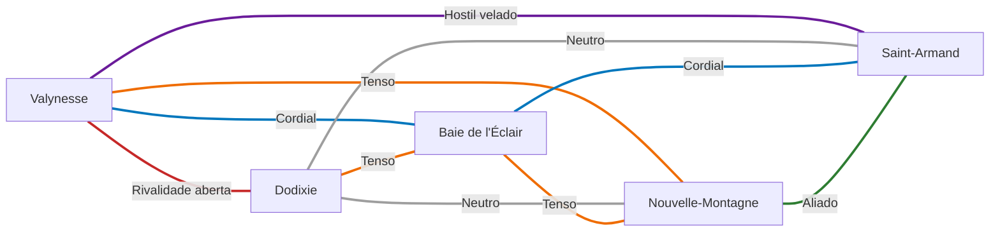

---
tags:
  - Mundo
  - Política
  - Cidades
---

# Relações entre cidades

Cada cidade tem um motivo para precisar e um motivo para desconfiar das outras. Esta página
mostra como as cinco grandes cidades de Gallancourt se relacionam quando a campanha começa, com
a **visão de cada lado**.

!!! info "Fontes"
    As visões de cada cidade vêm do documento *História de Gallancourt* (`CANON`). O estado de cada
    par é um resumo dessas visões. Notas marcadas `SEGREDO` descrevem o que as cidades não sabem.

## Escala de relação

| Estado | Significado |
|---|---|
| 🟢 **Aliado** | Relação positiva e dependência assumida. |
| 🔵 **Cordial** | Cooperação real, com atritos administráveis. |
| ⚪ **Neutro** | Contato pragmático, sem afeto nem hostilidade. |
| 🟠 **Tenso** | Negócios em comum sobre ressentimento real. |
| 🟣 **Hostil velado** | Medo e vigilância mútua por trás da cooperação formal. |
| 🔴 **Rivalidade aberta** | Disputa declarada por poder. |

## Mapa de relações

## Matriz

| | Valynesse | Dodixie | Baie de l'Éclair | Saint-Armand | Nouvelle-Montagne |
|---|---|---|---|---|---|
| **[Valynesse](../cidades/valynesse.md)** | — | 🔴 Rivalidade aberta | 🔵 Cordial | 🟣 Hostil velado | 🟠 Tenso |
| **[Dodixie](../cidades/dodixie.md)** | 🔴 Rivalidade aberta | — | 🟠 Tenso | ⚪ Neutro | ⚪ Neutro |
| **[Baie de l'Éclair](../cidades/baie-de-l-eclair.md)** | 🔵 Cordial | 🟠 Tenso | — | 🔵 Cordial | 🟠 Tenso |
| **[Saint-Armand](../cidades/saint-armand.md)** | 🟣 Hostil velado | ⚪ Neutro | 🔵 Cordial | — | 🟢 Aliado |
| **[Nouvelle-Montagne](../cidades/nouvelle-montagne.md)** | 🟠 Tenso | ⚪ Neutro | 🟠 Tenso | 🟢 Aliado | — |

## Os dez pares

### Valynesse × Dodixie

**Estado:** 🔴 Rivalidade aberta

| | |
|---|---|
| **Visão de Valynesse** | Rivalidade política e econômica. Dodixie, a cidade mais rica, deseja influenciar o governo central, e Valynesse resiste a essa interferência. |
| **Visão de Dodixie** | Rivalidade aberta pelo controle do governo: Dodixie acredita que deveria ser a nova capital devido ao seu poder econômico, e seus aristocratas apoiam em segredo iniciativas para enfraquecer a capital. |

- Scyras Corbeau quer vingar o pai, traído por aristocratas da capital, e quebrar a hegemonia da velha nobreza.
- Camille Brissac é a face pública da campanha de Dodixie pela capital.
- O Leilão de Cristal (Valynesse) e o Leilão Real (Dodixie) mantêm uma rixa especial.

### Valynesse × Baie de l'Éclair

**Estado:** 🔵 Cordial

| | |
|---|---|
| **Visão de Valynesse** | Relação comercial saudável, mas com conflitos pelo controle das taxas marítimas. |
| **Visão de Baie de l'Éclair** | Relação comercial importante, mas instável, pelo controle das tarifas de importação e exportação. |

### Valynesse × Saint-Armand

**Estado:** 🟣 Hostil velado

| | |
|---|---|
| **Visão de Valynesse** | A capital teme o poder militar da cidade-fortaleza e mantém uma postura de vigilância constante. |
| **Visão de Saint-Armand** | Relação delicada, pois a capital teme uma possível tomada de poder por Saint-Armand. |

- `SEGREDO` O medo tem fundamento: Armand Saint-Laurent sonda seus oficiais mais leais para um golpe contra a aristocracia.

### Valynesse × Nouvelle-Montagne

**Estado:** 🟠 Tenso

| | |
|---|---|
| **Visão de Valynesse** | Nouvelle-Montagne é uma importante fornecedora de alimentos para a capital. |
| **Visão de Nouvelle-Montagne** | Fornece alimentos à capital, mas sofre com os tributos abusivos impostos pelos aristocratas de Valynesse. |

### Dodixie × Baie de l'Éclair

**Estado:** 🟠 Tenso

| | |
|---|---|
| **Visão de Dodixie** | Comércio forte, mas tensão com os piratas e corsários que perturbam as rotas. Dodixie se sente ameaçada pelo poderio naval de Baie, que pode atrapalhar sua expansão comercial marítima. |
| **Visão de Baie de l'Éclair** | Cooperação comercial mútua, mas descontentamento com o aumento da pirataria e com a tentativa de Dodixie de roubar parte das rotas comerciais. |

- `SEGREDO` Parte dessa pirataria é a frota de Rochefort, paga por Scyras Corbeau, que às vezes ataca navios de Dodixie para manter as aparências.

### Dodixie × Nouvelle-Montagne

**Estado:** ⚪ Neutro

| | |
|---|---|
| **Visão de Dodixie** | Relações comerciais neutras; os fazendeiros de Nouvelle-Montagne preferem negociar diretamente com Dodixie para evitar as taxas da capital. |
| **Visão de Nouvelle-Montagne** | Relação comercial relativamente pacífica. |

- Dodixie conspira para se aliar a Nouvelle-Montagne, e o Chefe Pierre Montaigne defende um bloco com Dodixie.
- `SEGREDO` Élodie Vaucluse troca correspondência secreta com Camille Brissac.

### Dodixie × Saint-Armand

**Estado:** ⚪ Neutro

| | |
|---|---|
| **Visão de Dodixie** | Respeita a cidade militarizada, mas a considera uma possível ameaça caso decida intervir nas disputas políticas do reino. |
| **Visão de Saint-Armand** | Respeito mútuo, mas os comerciantes de Dodixie temem que os militares interfiram na economia. |

- Pierre Montaigne quer as duas cidades num bloco com Nouvelle-Montagne.

### Baie de l'Éclair × Nouvelle-Montagne

**Estado:** 🟠 Tenso

| | |
|---|---|
| **Visão de Baie de l'Éclair** | Relação tensa, marcada pela extorsão nos preços de transporte de grãos e animais. |
| **Visão de Nouvelle-Montagne** | Relação conflituosa: Baie de l'Éclair impõe altas taxas de transporte e tenta controlar a economia da região. |

- `SEGREDO` Lucien de Saint-Pierre financia com a própria fortuna uma frota pirata contra os navios de Baie, para forçá-la a negociar.

### Baie de l'Éclair × Saint-Armand

**Estado:** 🔵 Cordial

| | |
|---|---|
| **Visão de Baie de l'Éclair** | Cooperam militarmente, mas existe tensão entre os almirantes de Baie e os generais de Saint-Armand sobre qual força deveria ser mais proeminente no reino. |
| **Visão de Saint-Armand** | Cooperação militar, com uma disputa latente sobre a primazia naval do reino. |

### Nouvelle-Montagne × Saint-Armand

**Estado:** 🟢 Aliado

| | |
|---|---|
| **Visão de Nouvelle-Montagne** | Relação positiva: fornece mantimentos aos soldados da cidade-fortaleza. |
| **Visão de Saint-Armand** | Relação amigável: Saint-Armand depende dos suprimentos produzidos na região. |

- O pacto de alimento em troca de proteção nasceu no Massacre da Aurora Velada; a Intendente-Geral Juliette Clermont mantém a ligação.

## Relações com L'Ordre de Célestien

Todas as cidades de Gallancourt tratam L'Ordre como inimigo. O que varia é a forma do contato:

| Lado de Gallancourt | Contato com L'Ordre |
|---|---|
| Saint-Armand | Principal linha de defesa; a Patrulha da Fronteira vigia a Cicatriz — sob o comando de um traidor `SEGREDO` |
| Valynesse | O Santuário do Sol Velado guarda a velha fé, que pode ajudar contra L'Ordre; as redes de Beaumont vigiam o leste |
| Dodixie | L'Ordre já agiu nos arredores da cidade: o massacre da família Enry `SEGREDO` |
| Baie de l'Éclair | A Magocracia e a diversidade cosmopolita da cidade são tudo o que a doutrina da pureza rejeita |
| Nouvelle-Montagne | O celeiro foi o primeiro grande alvo da Coroa durante a guerra |

Ver também: [Intrigas da nobreza](intrigas-da-nobreza.md) · [Teia política](teia-politica.md) ·
[Economia política](economia.md).
