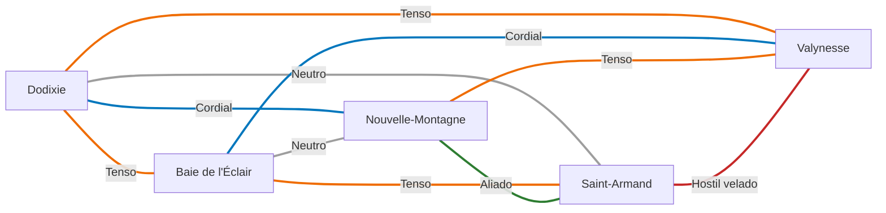

---
tags:
  - Mundo
  - Política
  - Cidades
---

# Relações entre cidades

Cada cidade da Aliança tem **um motivo para precisar** e **um motivo para desconfiar** de cada
uma das outras. É dessa tensão que nascem as intrigas da campanha.

!!! info "Como ler"
    O motivo **positivo** marcado com `CANON` vem do dossiê. Os demais motivos, os estados e os
    ganchos são `POSSIBILIDADE`: propostas para o autor aprovar, ajustar ou descartar.

## Escala de relação

| Estado | Significado |
|---|---|
| 🟢 **Aliado** | Interesses alinhados e dependência assumida. |
| 🔵 **Cordial** | Relação boa, mas com atritos administráveis. |
| ⚪ **Neutro** | Contato pragmático, sem afeto nem hostilidade. |
| 🟠 **Tenso** | Cooperação formal sobre desconfiança real. |
| 🔴 **Hostil velado** | Sorrisos no conselho, facas nos bastidores. |

## Mapa de relações

## Matriz

| | Dodixie | Baie de l'Éclair | Nouvelle-Montagne | Saint-Armand | Valynesse |
|---|---|---|---|---|---|
| **[Dodixie](../cidades/dodixie.md)** | — | 🟠 Tenso | 🔵 Cordial | ⚪ Neutro | 🟠 Tenso |
| **[Baie de l'Éclair](../cidades/baie-de-l-eclair.md)** | 🟠 Tenso | — | ⚪ Neutro | 🟠 Tenso | 🔵 Cordial |
| **[Nouvelle-Montagne](../cidades/nouvelle-montagne.md)** | 🔵 Cordial | ⚪ Neutro | — | 🟢 Aliado | 🟠 Tenso |
| **[Saint-Armand](../cidades/saint-armand.md)** | ⚪ Neutro | 🟠 Tenso | 🟢 Aliado | — | 🔴 Hostil velado |
| **[Valynesse](../cidades/valynesse.md)** | 🟠 Tenso | 🔵 Cordial | 🟠 Tenso | 🔴 Hostil velado | — |

## Os dez pares

### Dodixie × Baie de l'Éclair

**Estado:** 🟠 Tenso `POSSIBILIDADE`

| | |
|---|---|
| **Motivo positivo** `CANON` | As duas marinhas da Aliança: rotas comerciais e operações navais conjuntas. |
| **Motivo negativo** `POSSIBILIDADE` | Disputam as mesmas rotas e portos. Baie sofreu pirataria durante a guerra, e o corsário Rochefort, que ataca essas rotas, age em segredo para a Casa Corbeau. Se Baie descobrir, a aliança naval racha. |
| **Gancho** | Uma carga de Jean Vigny é afundada perto das Ilhas do Relâmpago. Os sobreviventes juram ter visto as velas de Rochefort, e Vigny exige justiça ao conselho. |

### Dodixie × Nouvelle-Montagne

**Estado:** 🔵 Cordial `POSSIBILIDADE`

| | |
|---|---|
| **Motivo positivo** `CANON` | Dodixie compra grão e escoa a produção de Nouvelle-Montagne pelo mar. |
| **Motivo negativo** `POSSIBILIDADE` | Dodixie depende de comida que não produz, e Élodie Vaucluse defende usar o grão como alavanca política. A frota pirata financiada por Lucien de Saint-Pierre ataca navios, possivelmente os de Rochefort. |
| **Gancho** | O preço do grão dobra de repente em Dodixie. Alguém em Nouvelle-Montagne está testando até onde pode apertar. |

### Dodixie × Saint-Armand

**Estado:** ⚪ Neutro `POSSIBILIDADE`

| | |
|---|---|
| **Motivo positivo** `CANON` | Saint-Armand garante a proteção terrestre que uma cidade naval não tem. |
| **Motivo negativo** `POSSIBILIDADE` | Corbeau vê um exército cada vez maior como ameaça à própria autonomia; Saint-Armand se ressente de que a marinha fique com a glória e o dinheiro. As redes de espionagem de Corbeau podem saber dos planos de golpe de Armand. |
| **Gancho** | Um mensageiro de Saint-Armand é encontrado morto nos canais com cartas cifradas para ninguém menos que a duquesa. |

### Dodixie × Valynesse

**Estado:** 🟠 Tenso `POSSIBILIDADE`

| | |
|---|---|
| **Motivo positivo** `CANON` | Política e espionagem: Valynesse coordena, Dodixie informa e financia. |
| **Motivo negativo** `POSSIBILIDADE` | Duas redes de espionagem (Corbeau e Beaumont) vigiam uma à outra. Scyras desconfia de que o Doge governa como um rei sem coroa. |
| **Gancho** | Os jogadores descobrem que uma figura respeitada de Dodixie envia relatórios semanais a Valynesse. |

### Baie de l'Éclair × Nouvelle-Montagne

**Estado:** ⚪ Neutro `POSSIBILIDADE`

| | |
|---|---|
| **Motivo positivo** `POSSIBILIDADE` | Baie compra grão e mármore; Nouvelle-Montagne precisa das rotas do oeste para vender. |
| **Motivo negativo** `POSSIBILIDADE` | O controle de Vigny sobre as rotas encarece o frete; a frota pirata ligada a Lucien de Saint-Pierre ataca justamente as rotas de Baie. |
| **Gancho** | Vigny oferece frete gratuito a Nouvelle-Montagne em troca de um único favor: o nome de quem paga os piratas. |

### Baie de l'Éclair × Saint-Armand

**Estado:** 🟠 Tenso `POSSIBILIDADE`

| | |
|---|---|
| **Motivo positivo** `POSSIBILIDADE` | A Torre do Trovão poderia dar à fronteira magia de guerra que nenhum exército tem. |
| **Motivo negativo** `POSSIBILIDADE` | Kaelen Thorne se recusa a pôr a Torre a serviço do exército; Armand quer tempestades como arma. A fé tradicional de Saint-Armand desconfia de uma cidade governada por magos. |
| **Gancho** | Um aprendiz da Torre desaparece perto de Saint-Armand. A Torre acusa o exército de sequestrá-lo para aprender seus segredos. |

### Baie de l'Éclair × Valynesse

**Estado:** 🔵 Cordial `POSSIBILIDADE`

| | |
|---|---|
| **Motivo positivo** `CANON` | Comércio e política: Baie vende, Valynesse financia. |
| **Motivo negativo** `POSSIBILIDADE` | Os financistas de Valynesse querem taxar as rotas de Vigny; a Casa Lumière teme ser reduzida a província do Doge. |
| **Gancho** | O Doge propõe uma "taxa de defesa" sobre todo navio que entrar em Baie. Jeanesse Lumière precisa decidir se aceita ou lidera uma revolta no conselho. |

### Nouvelle-Montagne × Saint-Armand

**Estado:** 🟢 Aliado `POSSIBILIDADE`

| | |
|---|---|
| **Motivo positivo** `CANON` | Alimento em troca de proteção: o pacto nascido no Massacre da Aurora Velada, mantido por Juliette Clermont. |
| **Motivo negativo** `POSSIBILIDADE` | Dependência gera ressentimento: os clãs discutem se o preço da proteção é justo, e Élodie quer renegociá-lo. Um golpe de Armand só funcionaria com o grão de Helga, que tem a chave nas mãos. |
| **Gancho** | Armand pede a Helga Roche que estoque grão "para a fronteira". Ela desconfia de que seja para outra coisa. |

### Nouvelle-Montagne × Valynesse

**Estado:** 🟠 Tenso `POSSIBILIDADE`

| | |
|---|---|
| **Motivo positivo** `CANON` | Nouvelle-Montagne alimenta a antiga capital. |
| **Motivo negativo** `POSSIBILIDADE` | Choque entre o poder do dinheiro (Magnetér) e o poder da comida (Roche). Valynesse se lembra de que sua fome tem dono. |
| **Gancho** | Uma dívida antiga de Valynesse com os clãs vence durante a crise. Pagar ou não pagar pode decidir de que lado a região fica na guerra. |

### Saint-Armand × Valynesse

**Estado:** 🔴 Hostil velado `POSSIBILIDADE`

| | |
|---|---|
| **Motivo positivo** `CANON` | Saint-Armand é a espada da Aliança; Valynesse paga por ela. |
| **Motivo negativo** `POSSIBILIDADE` | Armand considerou um golpe, e o alvo natural é a centralidade de Valynesse. Beaumont vigia o exército. Saint-Armand lembra que segurou o istmo enquanto os outros entravam na capital. |
| **Gancho** | Um oficial de Saint-Armand procura os jogadores discretamente: quer que levem uma carta lacrada ao Visconde Henri du Valois. |

## Relações com L'Ordre de Célestien

| Lado da Aliança | Lado de L'Ordre | Estado | Tensão | Oportunidade ilícita |
|---|---|---|---|---|
| Saint-Armand | Chantépierre | 🔴 Hostil velado | Vigilância mútua nos passos; é aqui que qualquer guerra começa. | Contrabando e deserções atravessam a fronteira nos dois sentidos. |
| Valynesse | Montclair de Lune | 🔴 Hostil velado | Guerra de espiões: Beaumont contra os tribunais de L'Ordre. | Thibault de la Rivière entregou segredos da Aliança a L'Ordre; ninguém sabe quanto. |
| Dodixie | L'Ordre | 🔴 Hostil velado | Embargo oficial; a cidade multicultural é tudo o que a doutrina da pureza odeia. | La Voile Noire lucra contrabandeando mercadorias e pessoas pela fronteira. |
| Baie de l'Éclair | L'Ordre | 🔴 Hostil velado | A magocracia é heresia aos olhos de L'Ordre. | Rotas marítimas próximas das águas orientais podem ser usadas para desembarques. |
| Nouvelle-Montagne | L'Ordre | 🟠 Tenso | O celeiro foi o primeiro alvo da Coroa; seria de novo. | Grão vendido às escondidas para o leste renderia fortunas a quem ousasse. |

Ver também: [Intrigas da nobreza](intrigas-da-nobreza.md) · [Teia política](teia-politica.md) ·
[A Segunda Guerra](../campanha/index.md).
