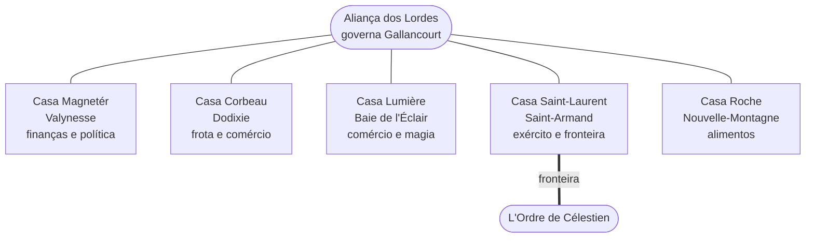

---
tags:
  - Visão geral
---

# Gallancourt em uma página

O essencial do cenário, como ele está quando a campanha começa.

## 1. O reino partido

A guerra civil dividiu o antigo reino em dois Estados, separados pela
[grande cordilheira](geografia/grande-cordilheira.md) e pela [Cicatriz](geografia/a-cicatriz.md):

| | **Gallancourt** (oeste) | **L'Ordre de Célestien** (leste) |
|---|---|---|
| **Governo** | [Aliança dos Lordes](faccoes/alianca-dos-lordes.md): aristocracia de cinco casas | Teocracia do Primat [Severin Marceau](personagens/severin-marceau.md) |
| **Cidades** | Cinco grandes cidades, cada uma governada por uma família | [Montclair de Lune](cidades/montclair-de-lune.md) (capital), [Chantépierre](cidades/chantepierre.md), [Valmire-sur-Rose](cidades/valmire-sur-rose.md) |
| **Fé** | Amaunator, com tolerância a outros povos e cultos | Doutrina da pureza |
| **Origem** | As casas que derrubaram a monarquia | O clero que causou a guerra e fugiu para o leste |

## 2. Cinco cidades, cinco famílias, uma aliança

| Cidade | Família | Líder | O que a cidade dá à Aliança |
|---|---|---|---|
| [Valynesse](cidades/valynesse.md) | [Magnetér](faccoes/casa-magneter.md) | [Doge Lorenzo Magnetér](personagens/lorenzo-magneter.md) | Capital; minas de gemas, luxo, espiões |
| [Dodixie](cidades/dodixie.md) | [Corbeau](faccoes/casa-corbeau.md) | [Marquesa Scyras Corbeau](personagens/scyras-corbeau.md) | Riqueza, madeira, frota do norte |
| [Baie de l'Éclair](cidades/baie-de-l-eclair.md) | [Lumière](faccoes/casa-lumiere.md) | [Duque Jeanesse Lumière](personagens/jeanesse-lumiere.md); [Arquimago Elian Lumière](personagens/elian-lumiere.md) na Torre do Trovão | Maior porto, melhores navios, magia |
| [Saint-Armand](cidades/saint-armand.md) | [Saint-Laurent](faccoes/casa-saint-laurent.md) | [Lorde Comandante Armand Saint-Laurent](personagens/armand-saint-laurent.md) | Exército e defesa da fronteira |
| [Nouvelle-Montagne](cidades/nouvelle-montagne.md) | [Roche](faccoes/casa-roche.md) | [Helga Roche](personagens/helga-roche.md) | Comida para todos |

As cidades governam juntas pelo **Conseil des Seigneurs** (Conselho dos Lordes).

**Nenhuma cidade se sustenta sozinha.** Se uma falhar, as outras quatro sofrem. Por isso elas
precisam umas das outras e, ao mesmo tempo, temem umas às outras.

## 3. Por que as cidades se aproximam e se afastam

| Par | Estado | Aproxima | Afasta |
|---|---|---|---|
| Nouvelle-Montagne × Saint-Armand | 🟢 Aliado | Alimento pela proteção | Saint-Armand depende da comida |
| Valynesse × Baie | 🔵 Cordial | Comércio saudável | Taxas marítimas e tarifas |
| Baie × Saint-Armand | 🔵 Cordial | Cooperação militar | Almirantes contra generais |
| Dodixie × Nouvelle-Montagne | ⚪ Neutro | Comércio direto, sem as taxas da capital | Pouco laço além do comércio |
| Dodixie × Saint-Armand | ⚪ Neutro | Respeito mútuo | Medo de que os militares interfiram |
| Dodixie × Baie | 🟠 Tenso | Comércio forte | Piratas, rotas roubadas, poder naval rival |
| Valynesse × Nouvelle-Montagne | 🟠 Tenso | A comida da capital | Tributos abusivos |
| Baie × Nouvelle-Montagne | 🟠 Tenso | Transporte da produção | Extorsão nos fretes |
| Valynesse × Saint-Armand | 🟣 Hostil velado | O exército do reino | A capital teme um golpe |
| Valynesse × Dodixie | 🔴 Rivalidade aberta | Política e comércio | Dodixie quer ser a capital |

Tabela completa, com a visão de cada lado, em **[Relações entre cidades](mundo/relacoes-entre-cidades.md)**.

## 4. A nobreza: alianças, rivalidades e facas

Os nobres não se dividem só por cidade. Há acordos secretos, rivalidades comerciais, espiões
infiltrados e **conspirações de assassinato**. Alguns exemplos:

- 🕯️ [Scyras Corbeau](personagens/scyras-corbeau.md) paga o corsário
  [Rochefort](personagens/etienne-rochefort.md) para atacar os navios de Jean Vigny. `CANON`
- 🔥 [Armand Saint-Laurent](personagens/armand-saint-laurent.md) sonda oficiais para um golpe, e
  [Juliette Clermont](personagens/juliette-clermont.md) tenta frustrá-lo. `CANON`
- 🐍 [Thibault de la Rivière](personagens/thibault-de-la-riviere.md), comandante da Patrulha da
  Fronteira, trabalha para L'Ordre e entregou a família Enry. `CANON`
- 🗡️ [Jean Vigny](personagens/jean-vigny.md) contratou assassinos contra Rochefort. `POSSIBILIDADE`

Mapa completo em **[Intrigas da nobreza](mundo/intrigas-da-nobreza.md)**.

## Como navegar

| Quero saber sobre… | Vá para |
|---|---|
| O que aconteceu no passado | [História](historia/index.md) → [Cronologia](historia/cronologia.md) |
| Um lugar | [Cidades](cidades/index.md) ou [Geografia](geografia/index.md) |
| Uma pessoa | [NPCs](personagens/index.md) |
| Uma família ou organização | [Facções](faccoes/index.md) |
| Quem odeia quem | [Relações entre cidades](mundo/relacoes-entre-cidades.md) · [Intrigas da nobreza](mundo/intrigas-da-nobreza.md) |
| O que ainda não foi decidido | [Lacunas em aberto](mestre/lacunas.md) |
